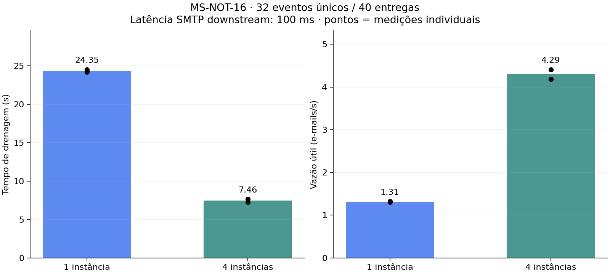
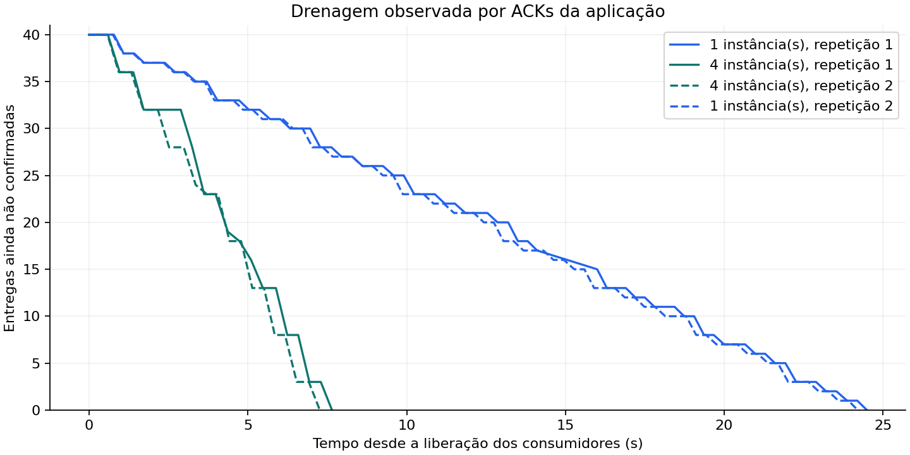

# Testes — MS-NOT-16

Data: 12/11/2026. Branch: `test/ms-not-16-escalabilidade`.

## Resultado executado

**BUILD SUCCESS** com Java 21.0.12.1: 161 testes locais e o experimento de integração com quatro rodadas, sem falhas, erros ou testes ignorados. Tempo total Maven: 9 minutos e 50 segundos. Execução: `9402e238-82ad-4515-a30e-3566ca26c433`. Log local: `target/ms-not-16-escala.log`.

Cada rodada confirmou 32 marcadores EMAIL, 32 envelopes SMTP com os destinatários esperados, oito republicações descartadas e uma notificação interna. Nenhuma falha de processamento, duplicação SMTP ou mensagem residual nas filas de trabalho, retry de e-mail e DLQ inspecionadas foi observada.

| Ordem | Repetição | Instâncias | Drenagem (s) | Vazão útil (e-mails/s) | Falhas / duplicações SMTP | Interna observada (ms) |
|---|---|---|---|---|---|---|
| 1 | 1 | 1 | 24,494 | 1,306 | 0 / 0 | 140 |
| 2 | 1 | 4 | 7,648 | 4,184 | 0 / 0 | 216 |
| 3 | 2 | 4 | 7,265 | 4,405 | 0 / 0 | 198 |
| 4 | 2 | 1 | 24,204 | 1,322 | 0 / 0 | 97 |

Com uma instância, a duração média foi **24,349 s** e a vazão média **1,314 e-mail/s**. Com quatro, **7,4565 s** e **4,294 e-mails/s**. A razão entre as vazões médias observadas foi **3,27x**, calculada após a execução. Não se trata de um ganho mínimo exigido pelo teste ou de uma previsão para produção.





Evidências preservadas no projeto: [manifesto e resultados](evidencias/ms-not-16/resultados.json), [CSV](evidencias/ms-not-16/resultados.csv), arquivos SVG dos gráficos e diretórios por rodada com amostras, configuração Toxiproxy e recursos efetivamente inspecionados. Os gráficos foram renderizados e inspecionados visualmente.

## Condições e interpretação

Docker Desktop 29.9.2 informou 12 CPUs e 8.182.255.616 bytes de memória (aproximadamente 7,62 GiB). Cada JVM recebeu teto de 1 CPU e 768 MiB, com heap máximo 384 MiB. A infraestrutura por rodada manteve os mesmos tetos e as mesmas imagens. SHA-256 da carga: `76b342143a7624d4e4d79365885aafb3e824f4f659cc1120e0dcf15beb3832d0`. O hash do JAR e os IDs das imagens constam nos arquivos de evidência.

O caminho de envio permanece sequencial dentro de cada consumidor de e-mail. A latência de 100 ms é aplicada a respostas SMTP e se repete durante a conversa, alongando a ocupação do consumidor. A CPU média amostrada pelo gauge da JVM variou de 0,187 a 0,195 entre as rodadas; o maior valor amostrado foi 0,675. Isso é compatível com espera de rede predominante neste ensaio, e não evidencia CPU continuamente no teto. Não foi realizada uma medição de saturação de PostgreSQL, RabbitMQ ou Mailpit.

As quatro instâncias participaram do trabalho: incluindo aquecimento, os sucessos por JVM foram `[11, 9, 10, 10]` e `[10, 10, 10, 10]`. A distribuição, o custo fixo de liberação/coleta e a serialização de eventoIds repetidos pelo lock transacional podem limitar a aproximação de uma escala linear; não foram isoladas as contribuições de cada um desses fatores. O próximo limite de capacidade não pode ser deduzido deste lote pequeno.

A notificação interna foi observada entre 97 e 216 ms nas quatro rodadas. Esse é o tempo de observação do experimento, não um percentil nem um SLA. Oito eventos de aquecimento totais por rodada não caracterizam regime permanente de JIT. Duas repetições mostram consistência local, sem produzir intervalo de confiança ou garantia de desempenho em outra infraestrutura. Serviços SMTP reais podem impor outros limites de conexões e vazão.

A consulta final ao Docker por label Testcontainers não encontrou containers residuais. A execução usa recursos descartáveis e não alterou a stack de desenvolvimento nem o backend.

## Reprodução

Com Java 21 e Docker em execução:

```powershell
.\mvnw.cmd -B -Pescala-it verify
```

Linux/macOS: `./mvnw -B -Pescala-it verify`. Não combine esse perfil com os demais. O JAR é empacotado antes do experimento e todos os dados são sintéticos e descartáveis. Não precisa de `.env` nem da stack Compose iniciada. O encerramento remove somente os recursos temporários criados pelo teste.

Parâmetros opcionais: `-Descala.eventos=32`, `-Descala.latencia-ms=100`, `-Descala.repeticoes=2`. Os intervalos aceitos são 16–1000 eventos, 1–2000 ms e 1–5 repetições; configurações grandes podem exceder os limites de duração do experimento. O padrão produz duas medições por quantidade de instâncias na ordem 1–4–4–1.

Dados brutos ficam em `target/ms-not-16/<execucao>/`: manifesto `resultados.json`, recursos inspecionados, configuração Toxiproxy, amostras de commits/ACKs/CPU, métricas finais, capturas SMTP e logs. Credenciais temporárias permanecem fora dos arquivos de evidência.

Para gerar os gráficos e CSV, use Python 3.10 ou superior:

```powershell
python -m venv target/ms-not-16-plot-env
target/ms-not-16-plot-env/Scripts/python.exe -m pip install -r infra/requirements-escala.txt
target/ms-not-16-plot-env/Scripts/python.exe infra/relatorio_escala.py target/ms-not-16/IDENTIFICADOR
```

Linux/macOS: use `target/ms-not-16-plot-env/bin/python`. O gráfico apresenta cada medição individual e a média, sem converter duas repetições em uma estimativa de confiança estatística. A curva mostra entregas ainda sem ACK observado, incluindo as duplicatas.

Se mudar o número de repetições do Maven, informe o mesmo valor com `--repeticoes N` ao gerar o relatório. O script exige todos os pares repetição/quantidade de instâncias e rejeita execuções parciais. Essa proteção foi exercitada durante a execução, e o script retornou erro ao receber somente a primeira medição.
